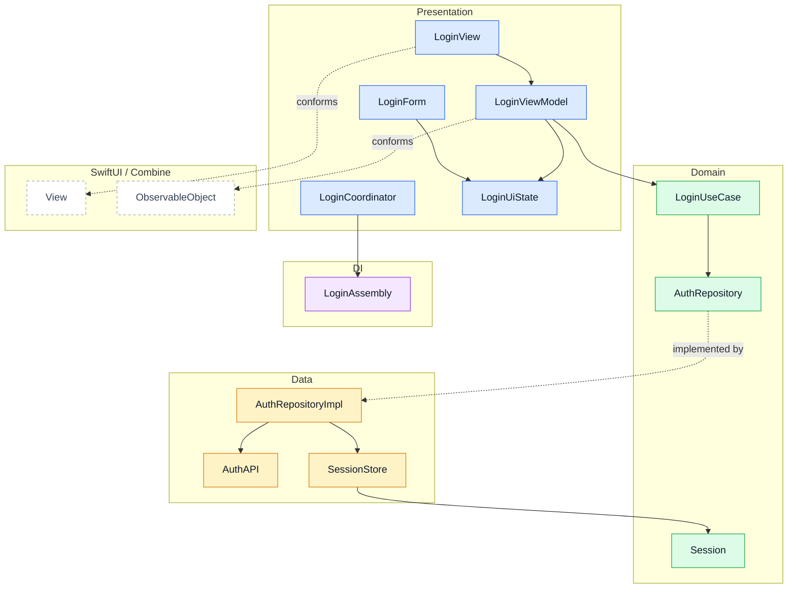
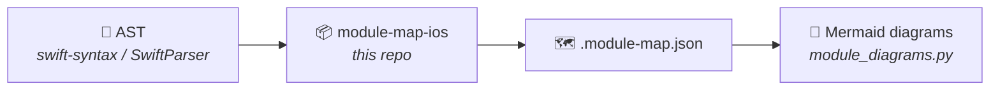

<div align="center">

# 🧩 ios-module-map

**Turn your Swift modules into the same architecture diagrams `android-module-map` draws for Kotlin.**

[](Package.swift)
[](Package.swift)
[](#%EF%B8%8F-limitations)

One Swift binary. No Python touched for the extractor. Same JSON schema → same renderer, every time.

[Quick Start](#-quick-start) · [What It Extracts](#-what-it-extracts) · [Configuration](#%EF%B8%8F-configuration) · [How It Works](#-how-it-works) · [Fixtures](#-fixtures) · [Limitations](#%EF%B8%8F-limitations)

</div>

---

`android-module-map` already knows how to turn `nodes`/`edges`/`external_nodes` into a layered
architecture diagram, a DI graph, a class table and layer violations — none of that is
Kotlin-specific once the JSON is in hand. **This repo is the other half of the pipeline**: it reads
Swift declarations and shapes them into that same JSON, so the Kotlin tool's renderer draws iOS
diagrams unchanged.

```
module-map-ios      Swift source  →  .module-map.json   (this repo)
module-diagrams      map JSON      →  .md / .html         (android-module-map)
```

<details>
<summary><b>📊 See what this JSON drives</b> (click to expand)</summary>

<br>

> Drawn downstream by `android-module-map`'s `module_diagrams.py`, from the exact JSON
> `swift run module-map-ios Fixtures/Login` produces in this repo — see
> [`Fixtures/Login/`](Fixtures/Login/).



`LoginUiState` is picked up as `role: state` and its `cases` (idle/loading/success/error) are
extracted even though it has no Kotlin analog — see [What It Extracts](#-what-it-extracts).

</details>

---

## ✨ Features

| | Feature | Description |
|---|---|---|
| 🧠 | **Role inference** | Name, protocol conformance, *and* attribute (`@Reducer`) based — covers MVVM/Clean vocabulary (`viewmodel`, `usecase`, `repository`...) and MVI/TCA vocabulary (`reducer`, `state`, `action`, `effect`) |
| 🔀 | **`calls` edges** | `receiver.method(...)` resolved through the receiver's declared type — the same rule `android-module-map`'s own edge validation uses, feeding flow/sequence diagrams downstream |
| 🧬 | **Enum `cases` extraction** | Name, labeled associated values, raw value — so an `Action`/`Intent`/`State` enum isn't just an empty node |
| 🔗 | **Cross-module resolution** | Point it at a `Package.swift` root (or a folder holding several modules) and a sibling module's type resolves to `origin: "project"` instead of a guessed `"library"` |
| 📦 | **SPM-aware** | A folder is one module; a folder with `Package.swift` turns every target into its own module |
| ♻️ | **Deterministic** | `--no-timestamp` → byte-identical JSON for the same code, safe to commit or check in CI |
| 🪶 | **No network, no AI model** | One Swift binary built on Apple's own `swift-syntax` — syntactic only, no type-checking |

---

## 🚀 Quick Start

> **Requires Swift 5.9+** (ships with Xcode or the Swift toolchain) **and a clone of
> [`android-module-map`](https://github.com/pfranccino/android-module-map)** for the diagram step.

```bash
swift run module-map-ios path/to/MyFeature --no-timestamp
python3 path/to/android-module-map/scripts/module_diagrams.py \
    path/to/MyFeature/docs/architecture/MyFeature.module-map.json \
    -o docs/architecture
```

`module-map-ios` writes `<module>.module-map.json` next to the module (or to `-o <dir>`, like the
Kotlin tool). Point it at:
- a folder (treated as one module), or
- a folder containing `Package.swift` (each SPM target becomes a module).

<details>
<summary><b>See expected output</b></summary>

```
[module_map_ios +  0.0s] Login: parsing 6 files...
[module_map_ios +  0.0s] Fixtures/Login/docs/architecture/Login.module-map.json: 12 nodes, 2 externals, 23 edges
```

```
Fixtures/Login/docs/architecture/
└── Login.module-map.json   ← structured map (nodes + edges), ready for module_diagrams.py
```

</details>

---

## ⚙️ Usage

```
module-map-ios <dir> [-o <output-dir>] [--no-timestamp]
```

| Option | Meaning |
|---|---|
| `<dir>` | A module folder, or a folder containing `Package.swift` (one module per target) |
| `-o, --output <dir>` | Write every `<module>.module-map.json` into this directory instead of next to each module |
| `--no-timestamp` | Leave `generated_at` out, so regenerating without code changes produces no diff — commit the JSON, or diff it in CI |

<details>
<summary><b>Map a single module</b> · <code>swift run module-map-ios Fixtures/Login</code></summary>

<br>

```bash
swift run module-map-ios Fixtures/Login --no-timestamp
```

```
[module_map_ios +  0.0s] Login: parsing 6 files...
[module_map_ios +  0.0s] Fixtures/Login/docs/architecture/Login.module-map.json: 12 nodes, 2 externals, 23 edges
```

</details>

<details>
<summary><b>Map every target of an SPM package</b> · <code>swift run module-map-ios Fixtures/MultiModule</code></summary>

<br>

Point it at a folder containing `Package.swift` and every target becomes its own module, with
cross-module references resolving to `origin: "project"` instead of a guessed `"library"`.

```bash
swift run module-map-ios Fixtures/MultiModule --no-timestamp
```

```
[module_map_ios +  0.0s] Core: parsing 1 files...
[module_map_ios +  0.0s] Feature: parsing 1 files...
[module_map_ios +  0.0s] Fixtures/MultiModule/Sources/Core/docs/architecture/Core.module-map.json: 1 nodes, 0 externals, 0 edges
[module_map_ios +  0.0s] Fixtures/MultiModule/Sources/Feature/docs/architecture/Feature.module-map.json: 1 nodes, 1 externals, 3 edges
```

`Feature.module-map.json`'s `NetworkClient` resolves with `module: "Core"`, not `"library"`.

</details>

<details>
<summary><b>Collect every map in one output folder</b> · <code>-o</code></summary>

<br>

```bash
swift run module-map-ios path/to/Project -o docs/maps
```

Writes every `<module>.module-map.json` into `docs/maps` instead of inside each module — handy
when `module_diagrams.py` should read them from one place.

</details>

---

## 📄 What It Extracts

For every `class`/`struct`/`enum`/`protocol` (syntactic only — no type-checking, same tradeoff
`android-module-map` makes for Kotlin):

- **declaration shape** — supertypes/conformances, stored properties, functions (signature as
  text), the richest `init` as `constructor`, attributes, doc comments (`///`), and an enum's
  `cases` (name, labeled associated values, raw value)
- **role**, inferred by name, conformance, *and* attribute — reusing Kotlin's own vocabulary
  wherever there's a direct analog, so `module_diagrams.py`'s built-in by-role layer defaults
  already place these correctly, plus an MVI/TCA vocabulary with no Kotlin analog of its own:

  | Swift shape | role | Kotlin analog |
  |---|---|---|
  | `*ViewModel`, conforms to `ObservableObject` | `viewmodel` | ViewModel |
  | `UIViewController` subclass, `*ViewController` | `activity` | Activity |
  | conforms to `View`, `*Screen` | `composable` | `@Composable` function |
  | `*UseCase`, `*Interactor` | `usecase` | UseCase |
  | `*Repository`, `*RepositoryImpl` | `repository` | Repository |
  | `*Service`, `*Client`, `*API`/`*Api` | `api_service` | Retrofit API |
  | `*Assembly`, `*Container`, `*Resolver`, `*Factory` | `di_module` | Hilt module |
  | `*Coordinator` | `coordinator` | *(none — see [Configuration](#%EF%B8%8F-configuration))* |
  | `*Reducer`, `@Reducer`/conforms `Reducer`/`ReducerProtocol` (TCA) | `reducer` | *(none — see [Configuration](#%EF%B8%8F-configuration))* |
  | enum `*Action`/`*Intent` | `action` | *(none — see [Configuration](#%EF%B8%8F-configuration))* |
  | `*State` (struct or enum) | `state` | *(none — see [Configuration](#%EF%B8%8F-configuration))* |
  | `*Effect`, `*Middleware` | `effect` | *(none — see [Configuration](#%EF%B8%8F-configuration))* |
  | explicit `: Store` conformance (bare `*Store` name isn't enough — too common for plain caches) | `store` | *(none — see [Configuration](#%EF%B8%8F-configuration))* |

- **edges**, from what's visible in the syntax alone: `extends` (a class's first inherited type),
  `implements` (protocol conformances), `depends_on` (initializer parameters — the common
  constructor-injection pattern), `uses_type` (stored property types), and **`calls`** —
  `receiver.method(...)` inside a function body, resolved through the receiver's declared type (a
  property, constructor param, or `self`), the same "declared type of the receiver" rule
  `android-module-map`'s own edge validation uses. This is what feeds `module_diagrams.py`'s flow
  and sequence diagrams — e.g. `LoginViewModel.submit` → `LoginUseCase.invoke` →
  `AuthRepository.login` in `Fixtures/Login`. No `instantiates` yet. A call through a local
  variable or a chained expression (`foo().bar()`) isn't resolved — only self members — so a flow
  can be missing a hop, never show a wrong one.
- **`id`s are module-qualified** (`Login.LoginUseCase`, not just `LoginUseCase`) and
  **cross-module references resolve to `origin: "project"`** when a run covers more than one
  module. A type declared in more than one module with the same simple name is ambiguous and
  falls back to `"library"` rather than guessing; a type genuinely outside this run (framework,
  external SPM package) does too.

---

## 🛠️ Configuration

`module-map-ios` itself never reads `.module-map.toml` — it only writes the JSON. Everything below
is consumed by `android-module-map`'s `module_diagrams.py` when it draws the diagram.

`coordinator` and the MVI/TCA roles (`reducer`/`state`/`action`/`effect`/`store`) have no Kotlin
equivalent, so `module_diagrams.py`'s built-in defaults don't know where any of them belong — drop
a `.module-map.toml` next to the module (same mechanism `android-module-map`'s README documents):

```toml
[layers.by_role]
coordinator = "Presentation"
reducer = "Presentation"
state = "Presentation"
action = "Presentation"
effect = "Domain"
```

See [`Fixtures/Login/.module-map.toml`](Fixtures/Login/.module-map.toml) and
[`Fixtures/MVIFeature/.module-map.toml`](Fixtures/MVIFeature/.module-map.toml) for working
examples.

---

## 🔍 How It Works



Two passes, so cross-module edges resolve correctly even on a single run:

1. **Parse** every module discovered under the given path, building a global registry of
   `name → (module, id)` as it goes.
2. **Build & write** each module's map, now that the registry covers every module in this run —
   so a reference to a sibling module's type can resolve to `origin: "project"` instead of
   guessing `"library"`.

<details>
<summary><b>Edge validation</b> — how a <code>calls</code> edge avoids guessing</summary>

<br>

A `receiver.method(...)` call site only becomes an edge when `receiver`'s declared type is known
without type-checking:

1. `self` → the enclosing type
2. a stored property → its declared type annotation
3. a constructor parameter → its declared type

No match (a local variable, a static call, a chained expression) → no edge. **Missing arrow >
false arrow.**

</details>

<details>
<summary><b>JSON map structure</b></summary>

<br>

| Key | Content |
|---|---|
| `module` | Name, directory, type (`spm-or-folder`) |
| `nodes` | Declarations: module-qualified `id`, `kind`/`swift_kind`, `role`, file, lines, doc, supertypes, properties, functions, constructor, cases |
| `external_nodes` | Symbols outside the module (`origin: "project"` or `"library"`) |
| `edges` | Typed relationships (`extends`/`implements`/`depends_on`/`uses_type`/`calls`) with `provenance`, `weight`, and `details` |
| `legend` | Meaning of each edge kind, provenance, and the `origin` field |

</details>

---

## 🧪 Fixtures

| Fixture | Demonstrates | Regenerate |
|---|---|---|
| [`Fixtures/Login/`](Fixtures/Login/) | A small worked feature (Domain/Data/UI/DI) exercising the whole pipeline — flow `LoginViewModel.submit → LoginUseCase.invoke → AuthRepository.login` | `swift run module-map-ios Fixtures/Login --no-timestamp` |
| [`Fixtures/MultiModule/`](Fixtures/MultiModule/) | A two-target `Package.swift` (`Core`, `Feature` depending on it) for cross-module resolution | `swift run module-map-ios Fixtures/MultiModule --no-timestamp` |
| [`Fixtures/MVIFeature/`](Fixtures/MVIFeature/) | A TCA-shaped feature: `@Reducer` struct with no explicit `: Reducer` conformance, an `Action` enum with associated values, a `State` struct, an `Effect` depending on a client protocol | `swift run module-map-ios Fixtures/MVIFeature --no-timestamp` |

---

## 🧪 Testing

```bash
swift build
swift test
```

`swift test` needs a full Xcode install — a Command Line Tools–only install has neither `XCTest`
nor `Testing` available, even though `swift build`/`swift run` work fine. `Tests/` is written
against Swift Testing (`import Testing`, `@Test`), ready for whenever Xcode is present.

---

## ⚠️ Limitations

> Known boundaries for this first version — not bugs.

- **Syntactic only** — no type-checking, so a name collision between two locally-declared types
  with the same simple name isn't disambiguated.
- **`calls` only resolves self/property/param receivers** — a call through a local variable, a
  static/type-level call (`Foo.bar()`), or a chained expression isn't captured. Enough for the
  DI-driven chains that matter for flow diagrams (ViewModel → UseCase → Repository → API); not a
  full call graph.
- **`Package.swift` read by regex** — target names and `Sources/<name>` paths only; no manifest
  execution, so custom target `path:` overrides or plugin-generated targets aren't seen. Same
  tradeoff as the Kotlin tool reading `build.gradle.kts` without running Gradle.
- **Extension members aren't merged** — a type's methods added via `extension Foo { ... }`
  elsewhere aren't attached to `Foo`'s node yet.
- **No neighbor-less layer for plain data types** — a struct with no role and no typed neighbor
  (e.g. a bare DTO) lands in `Other`, same as the Kotlin tool's behavior for an un-roled data
  class.
- **Function-signature edges aren't extracted** — only `constructor` and stored `properties` feed
  `depends_on`/`uses_type`; parameter/return types of regular functions don't yet (the richest
  signal for DI is already covered via initializers).
- **Reducer composition is invisible** — `var body: some ReducerOf<Self> { Scope(...) { Child() };
  Reduce { ... } }` is a computed property; its type (`some ReducerOf<Self>`) ends up as
  `uses_type` noise and the `Scope`/`CombineReducers` composition inside the closure isn't walked,
  so a parent↔child reducer relationship produces no edge.
- **Property-wrapper dependencies without an explicit type annotation don't get an edge** —
  `@Dependency(\.apiClient) var apiClient` (type inferred from the key path, no `: APIClient`)
  extracts no `type`, so no `uses_type` edge. Give it an explicit annotation if the edge matters.
- **No `handles`-style edge from `Action` case to `Reducer`** — the `switch action { case .foo:
  ... }` pattern-match isn't a `receiver.method()` call, so which reducer handles which action
  isn't captured as an edge yet; the `cases` list on the `Action` node is the only signal for that
  today.

---

## 🗺️ What's Next

The actual motivation for this tool is comparing an iOS module map against an Android one —
counting use cases, repositories, etc. on one platform and scaffolding the equivalent boilerplate
on the other when a feature exists on only one side. That diffing/generation step is intentionally
**not** part of this repo; it's planned as a separate tool that consumes two `.module-map.json`
files (one from here, one from `android-module-map`) and is scoped separately.

---

<div align="center">

Built on Apple's [`swift-syntax`](https://github.com/apple/swift-syntax). No Gradle, no Python, no
AI model in this half of the pipeline.

</div>
